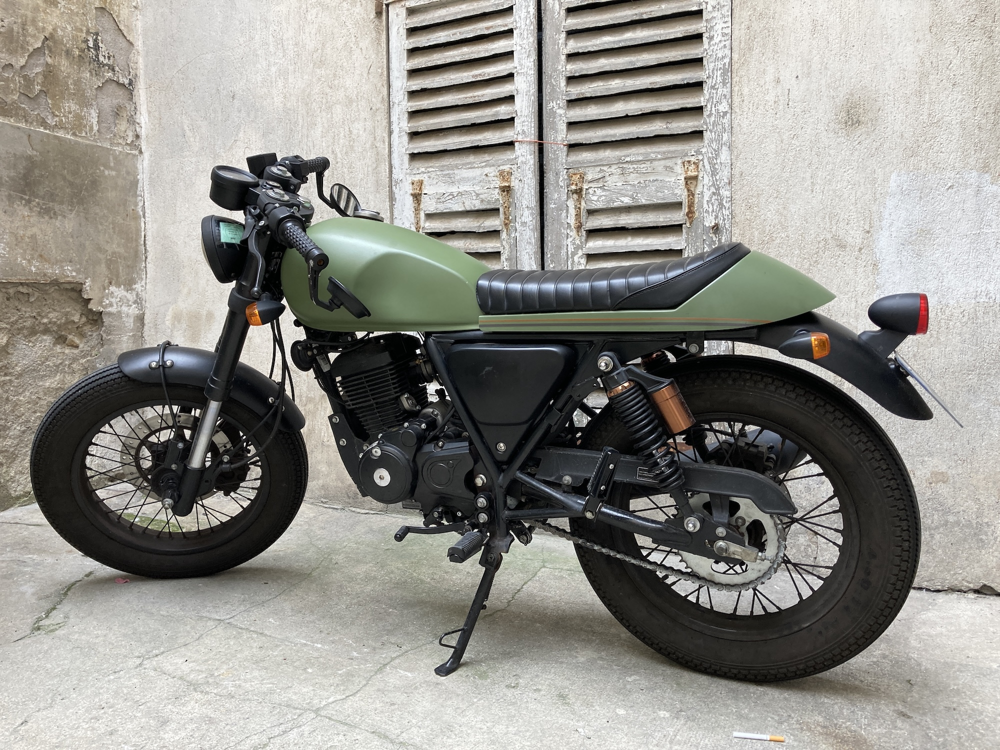
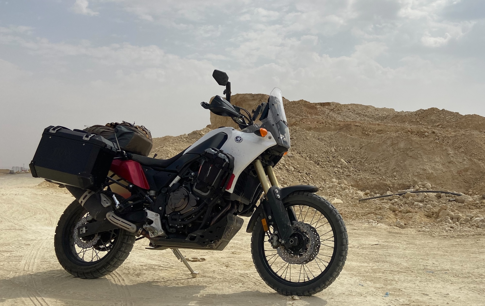
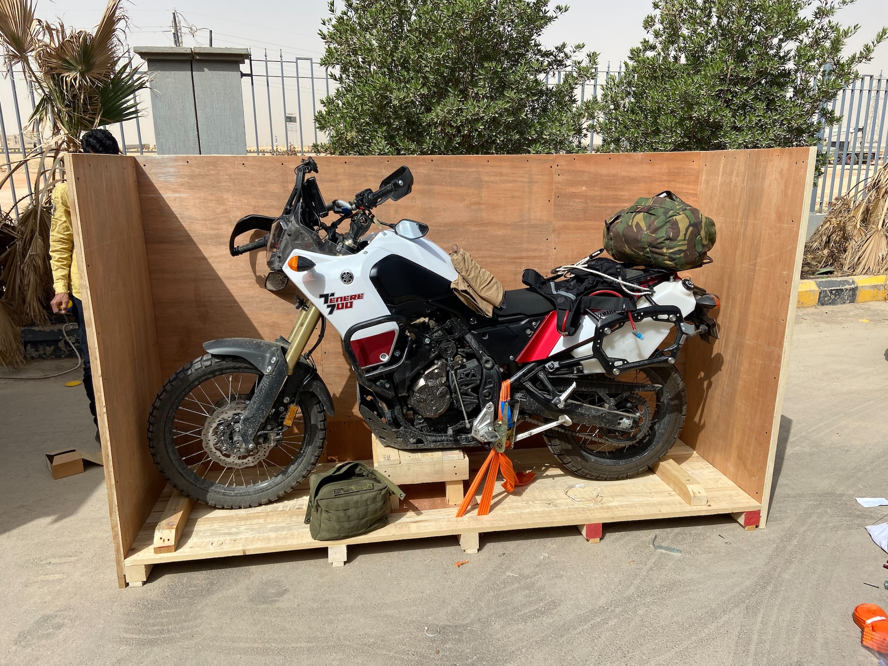
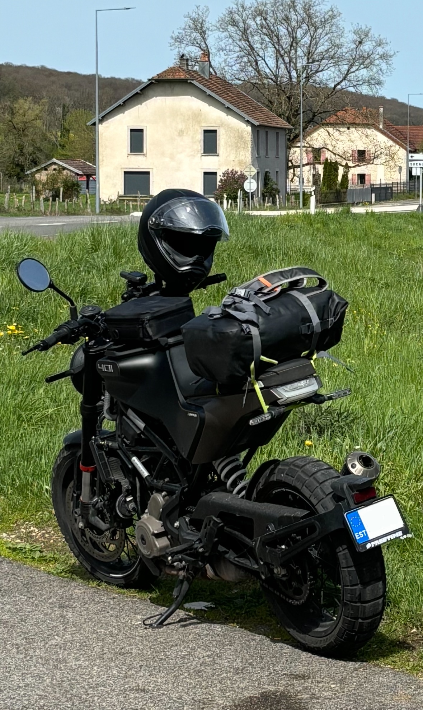
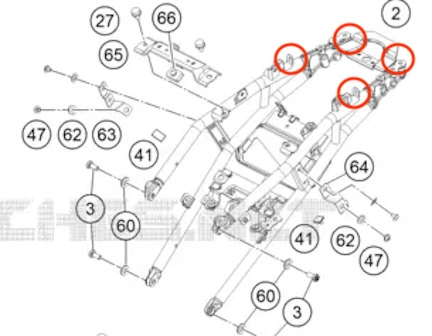
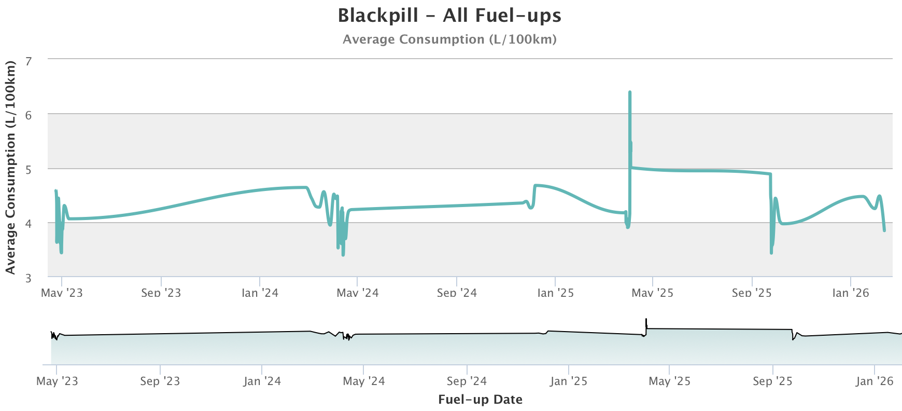

When I told my motorcycle friends I was going to buy a Husqvarna Svartpilen 401, I was ribbed relentlessly. To my North American friends, buying any bike with a 400cc single AFTER having bought a Tenere 700 sounded like a downgrade on all fronts; anything that taps out at 140km/h sounds dreadfully boring to a Saint Lawrence valley homeboy who's not used to riding in the mountains. My european friends also saw it as a downgrade, seeing that I was going from a full-A licence bike to an A2, and had issues with the fact that the newer Pilen series are now made in India and not in Austria. 

After nearly three year in the saddle, I'm happy to report that all these friends have been proven wrong. The baby Svart, that I affectionately call my little lawnmower, does everything I want it to do and more, and turns out to have been an incredibly good value purchase. 

I'm writing this post to share my experience with this little bike. With my friends' sceptical comments in mind, I'll try to clarify what this bike is and what it can do, and hopefully clear up some fud that might steer some folks away from the great value that this bike offers.

## My prior experience

When I was considering this motorcycle, it was my third motorcycle purchase. I cut my teeth on a 125cc Archive AM64 in France for a bit under a year, putting a few thousand kilometers on it. Most of the riding was done in a 100km circle of my home, since highway riding was just about impossible - not enough weight, and definitely not enough power.

From there, I purchased a new Yamaha Tenere 700 in Saudi Arabia, which I toured extensively around the Gulf and europe, using it as my only daily driver vehicle in KSA; this bike is sitting at 18 500km, and was at about 15 000km when I bought my Svartpilen.

In the last year, I also put around 3000 km on a Honda CBR600RR which was loaned to me by a friend. 

These are basically the only bikes I've ever gotten on; I've very seldom borrowed, rented or test-drove anything else.

## Philosophy of use

The Tenere 700 was at some point temporarily imported to Europe, where I got to see first hand that it was kind of too big to be an urban bike. It performed very well in the mountain roads of my french riviera commute, was comfortable for both long and short trips, but it was a bit awkward to live with around town. 

With a 62.8 inch wheelbase and a 21-inch front wheel, the bike didn't fit in any of the motorcycle street parking spots in Monaco, over-hanging into the street by darn close to a foot if the wheel was not fully turned. Similarly, parking in tight quarters was made more complicated by the high center of gravity. Here is the bike in question being packed on it's way to Frankfurt.

It's not an accident that I bought the Tenere in Saudi; it's what I thought would be the most regionally appropriate bike in a large desertic country where long rides would be frequent. 

The idea of being regionally-appropriate is also what drove the purchase of the Svartpilen. After a bit of reflexion, I had selected the following criteria as my version of what would qualify as regionally-appropriate:

1. Engine performance limited to A2 spec to fit the licence I have in-region
2. Street-biased suspension and riding position, nothing too aggressive
3. Scrambler-y tires if possible, at at least not fully street bike
4. Low overall cost of use and maintenance
5. Good dealer support

Limiting things to A2 already significantly reduced my range of choice. Within this selection, getting a "regular" bike nerfed to A2 sounded like quite a waste from an insurance, maintenance perspective. I mostly wanted to stick to smaller bikes, but also didn't want to get any of the drastically under-poweredd 250CC ones. On the basis of this alone, the Husqvarna 401 / KTM 390 platform is more or less the only competitive offering, as at the time of my purchase most other bike manufacturers really didn't have something that's built exactly at the cusp of A2. As of 2026, Triumph's offerings in the 400cc range are interesting and probably warrant some research.

## My riding on the Svart

As of the time this post is written, the bike's odometer is just under 13 000 km. Since I don't live in Europe, much of the mileage was concentrated in a few major trips. Here's a few that I can recall:

* An 11-day b-road ride from Tallinn to Monaco
* A week-long, mostly highway sprint from the south of France to Hamburg and back
* A 5 day long "triangle" from Nice, to the east coast of France, to Paris and back to Nice

Apart from these longer trips, most of my riding was commuting on the sea-side roads between Nice and Monaco, with the occasional weekend trip here or there. 

I was initially very reticent about driving the Svartpilen for longer than a few hundred kilometers away, having been used to the far more comfortable T7; after having done as much quite a few times, I can now confirm that this reticence is unwarranted. Sure, it's not as comfortable as a bigger bike, but for the price tag and versatility, you should really just suck it up. At the end of the day, fuel capacity limits you to ~150km segments, which is perfectly reasonable if you take your fuel stops as an opportunity to stretch and hydrate.

## Design, build and quality

Many have opined about the design of this motorcycle, as it's very polarizing. Classics enthousiasts don't prefer it, but I think it looks great. I've previously described it as the platonic ideal of a motorcycle since it's side profile is extremely simple, to the point where it amounts to a a box with two wheels that one sits ON and not IN. The flat seat completing the lines of the front rack is one of my favourite design choices. 

The proportions are such that it looks like a mini scrambler, and doesn't have any of the unfortunate shoe-horned look of bikes like the MT03 with a tiny engine in an inappropriately large frame.

The trellis frame is also a nice design element, although I cannot say that the welding is the best I've seen. This is made apparent by the paint, which since it is glossy reflects many of shoddy welds.

Fairing are of totally acceptable quality, and taking them on and off is simple enough to not damage them in the process.

## Performance tuning

There's lots of talk of performance tuning on these things on internet forums, probably mostly because it's a relatively high-performance bike that appeals to beginners who don't know better. Auto journalist Matt Farah from [The Smoking Tire](http://thesmokingtire.com) has a relevant adage I'd fully endorse: always buy as much car (or in this case, motorcycle) as you can afford. 

While the Svart is probably best bang-for-buck in it's category, it just doesn't have the potential to transcend its class. It takes a certain level of maturity to understand this; I know, because I've been the overly optimistic, broke enthoustiast before. 

The truth of the matter is that over-doing things performance wise on this bike is a waste of money. Save up and get more bike if you want something that's faster / better handling / generally better. This is an A2 starter bike or a glorified scooter with a clutch... the sooner you accept it, the sooner you can just enjoy your ownership experience for what it is.

In my opinion, the most effective mods on this bike are either basic "breathing" mods aka intake or exhaust, and taking stuff off the bike to make it lighter.  In it's stock form, the bike probably has a few kilos you can shave off, in no particular order:

- Different exhaust, possibly with the [chamber delete](https://www.competitionwerkes.com/products/husqvarna-vitpilen-svartpilen-401-chamber-delete-2020-2021)
- Reflectors on front forks
- Passenger pegs with the [OEM exhaust hanger](https://www.husqvarna-motorcycles.com/en-us/technical-accessories.html?c1=1001563550&year=2023&segment=Naked%20Bike&model=F1322W6&product=1001550620)
- A tail tidy, my personal favourite being [this one](https://cults3d.com/en/3d-model/tool/husqvarna-401-tail-tidy-fender-eliminator-aus-plates)
- Front lugguage rack delete (in my opinion, not enough weight to warrant removing)
- Lightweight battery

## Luggage options

This is one area where owners will have to have to be creative; it's a small bike, and there just aren't that many good storage options commercially available. What rear racks are available extend too far back in my opinion, and are not worth upsetting the bike's center of gravity for how much storage you get. Side racks, the only good option of which I known being the [Unit Garage one](https://www.unitgarage.com/special_parts/bags_and_accessories/husqvarna_401_frame) are generally not symmetrical, and hence aren't really suited to carrying a ton of weight.

My solution to this dilemma was simply to use the rear section of the seat to put a smaller-sized drybag, strapped down the frame with Rokstraps.

This setup was later refined with short paracord "eyes" permanently tied to certain points of the rear subframe, which could be made to peek out of the rear seat assembly at the rear, and where it meets the front part of the seat. This provides 4 points where the strap of your choice can be snaked through, providing side/side and front/back anchor points. The paracord and be stowed in the inside of the seat assembly when not in use.

Combined with the front [rack magnetic bag](https://www.esprit-hva.com/sacoche-de-reservoir-28512919000.html) and a medium-sized backpack, I've carried a full single-person tent and sleeping bag setup and enough things to motocamp for a week or more. 

## Maintenance and reliability

Some friends of mine have for a long time been critical of KTM products generally on account of the cost of maintenance. This sounded reasonable to me seeing that they are known for high-strung, high-performance-density street bikes and enduro/motocross bikes, which aren't exactly the lowest-TCO kinds of bikes.

I ignored their impressions on account that the Svart 401 is in neither of the above categories, and seems to have been designed and engineered for urban daily riding. The components looked of rather good quality, and the maintenance manual indiciates no special attention required beyond what you would expect on any bike.

So far, I am proven right; despite only having put ~13000km on the Svart, there have been no extraordinary concerns regarding maintenance. Save for oil changes, I have not had to get anything replaced or repair. What tuning was necessary was routine and included into other services during my visits to the dealership. 

### Consumable lifespan

The only consumable I have had to change so far is one rear tire at around the 8000km mark. The 2:1 rear:front tire replacement schedule on tires seems to be true, and if I were to stretch them out I think you could probably get 20 000km out of the front tire. 

I had read somewhere that OEM SKUs of the Pirelli Scorpio Rallye STR are made of a different compound that is less hard-wearing than the same tire bought over the shelf. I can't say that my experience can confirm this rumour, as the rear tire lifetime certainly seems right.

The original tires are fine, but possibly still a bit too off-road biased for the kind of riding I've been doing. A lighter and more street-biased tire might be an interesting way to increase on-road performance and riding enjoyment; I've been eyeing the [Dunlop Mutants](https://www.dunlop-moto.com/en_gb/tires/mutant--mutant.html) as possible replacements for the originals once they are due. I have not checked if they are lighter.

None of the brake pads have require replacement yet, although they certain will need a bit of attention in the coming hundred miles. Front rotors have a slight wave in them, possibly from pad deposits, but certainly not enough to warrant immediate replacement.

### Dealer network

The dealership network is probably the greatest strength of KTM/Husqvarna as a brand, at leaset in continental europe; even in smaller markets, it's relatively easy to find a dealer with a good shop staffed with good people.

In Poland or in France, my impression is that all the techs were enthousiasts, and in certain cases went out of their way to accomodate last-minute visits during my longer trips. I only have good things to say about my dealership experience.

### Known issues

The only issues that I've had across all of my ownership experience so far are: 

1. Intermittent failure of the quick shifter for no apparent reason, which would self-reset every so often, more often than not after a stop/start cycle. The problem seemed to be particularly present in wet/cold weather with quick-shifting being mostly un-available in cold weather around 5 degrees or below.
2. A kind of "stalling" around 4k RPM at high load that felt like a fuel cut on a single ignition cycle.

For whatever reason, both of these issues have all but completely disappeared at about the 10 000km mark, for no reason that I could understand. It *feels* like a break-in issue, but it could also be a combination of ECU update + self-learning.

## Suspension tuning

One thing that you will feel on a completely stock bike is that the supension, particularly in the rear, is quite soft. Unladen and with a single rider, I was frequently bottoming out on speed bumps that were taken a bit too enthousiastically. With a passenger, the middle of the road setting in the rear is entirely inadequate, with even slight bumps resulting in the rear bottoming out. 

Luckily, this is why the bike was shipped with a progressive-rate spring. *Do not be tempted to source a special stiffer constant-rate spring for the rear before you're tried adjusting preload*. For me, two clicks stiffer made the big much more comfortable all-around, even with a passenger, by completely eliminating bottoming-out.

Overall, the travel front and rear is rather short to do anything other than light scrambler stuff, but with enough determination you can certainly bring it along for some light offroad, [as some Youtubers have proved](https://www.youtube.com/watch?v=s8BMpk0PPGA). 

## Fuel Economy

One of the most puzzling aspect of the this bike is how bad the fuel economy is compared to my other bikes. Filling up  with european 95-octane gasoline (which is often 5-10% ethanol), I'm averaging 4.1L/100km over the bikes lifetime; I've been very consistent with my recordings, so pretty confident with the accuracy of that number. See my [Fuelly logs here](https://www.fuelly.com/motorcycle/husqvarna/svartpilen_401/2022/max302/1198626). 

To me, it sounds quite high considering that my much heavier Tenere 700 with non-DOT dirt tires in a punishing environment, and double the displacement and cylinder count [has done about 4.7L/100km over its lifetime](https://www.fuelly.com/motorcycle/yamaha/xtz07_tenere_700/2021/max302/1127598). The only notable difference here is that the Gulf is much flatter than the southern France pre-alps, and the only type of fuel available there is unadulterated dinosaur juice. 

## Conclusion

Even used, and even considering the glut of offerings in this segment that have appeared in the past years, the Svartpilen 401 is still a great choice for a budget A2 motorcycle that can do a bit of everything. The newer version is still very affordable directly from the dealer, but buying a depreciated used 2nd generation model certainly isn't the worst thing you could buy.

Specially considering the [KTM Group's recent financial issues](https://brusselssignal.eu/2025/11/indias-bajaj-auto-takes-over-ktm-europes-biggest-motorcycle-maker/) which could be making all KTM/Husqvarna products cheaper, do consider this bike if you think it matches your needs.
