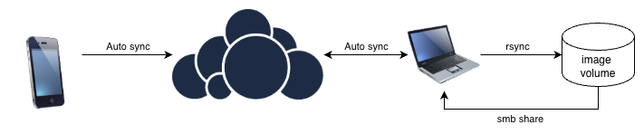
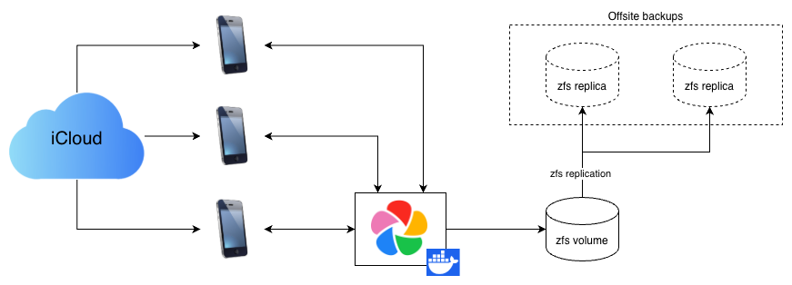

For years, I've been using a self-hosted instance of [Owncloud](https://owncloud.com) to manage a rudimentary form of auto-backup of all the pictures taken on my phone. With a combination of the [camera auto upload feature](https://doc.owncloud.com/android/latest/settings.html#camera-uploads) and a little shell script that I would run occasionally, my pictures would be periodically `rsync`'ed to an SMB-accessible volumes on one of my servers, and organized by date, and deleted from the ownCloud share.



This was always imperfect... transferring the files to the server meant I needed to have VPN access when I was away from home, since using via SMB is all but impossible over the internet. While not a huge problem while I lived in once place and mostly access the pictures through Lightroom, it did become a challenge a few years back when I become nomadic. The setup accomplished the intended job of automatically backing up my pictures, but it was really just storing files for safekeeping. There was no UX to speak of, let alone any sort of feature-parity with the likes of iCloud and Google Images. It was clunky to the point where getting my family to adopt this solution for image backup was basically impossible.

I had tried linking the files on my shares with [PhotoPrism](https://www.photoprism.app), but without a mobile app, it required keeping my Owncloud setup in the loop, adding to complexity and fragility. 

At some point this year I got tired of paying for extra storage on my iCloud family plan, and I found a solution that made a lot more sense.

## Immich

The solution to the problem I was trying to solve with clunky scripts had been there since 2022, and had significantly matured while I was still juggling with my scripts. [Immich](https://immich.app) is the perfect image backend and management intended to replaced cloud offerings. At the time I am writing this, it has basically everything I need to get my relatives on board in as frictionless a way as possible:

- Mobile app for all photo-management
- Auto-backup from all devices
- Easy iCloud import
- Metadata handling, grouping and searchability (by date, location, etc)
- Face recognition
- Context-based search on images based on OCR, people, places, detected objects, etc

In addition to being feature-complete, Immich greatly simplifies all the operational concerns around backing up remotely, since it runs in a simple docker-compose setup where files are easily mapped to a zfs volume that is very easy to replicate. The most basic install comes with very sensible defaults that automatically does database backups periodically, and if you map those to a volume that is replicated, that's all you need to sleep soundly at night knowing your instance is fully backed up.

This is what my workflow now looks like:



The SMB access is gone, but that's made completely irrelevant by the fact that I have no desire to use an external app to manage my photo libraries. Because of it's large user base, there are plugins for just about anything I would hypothetically want to use anyways, including [Lightroom](https://github.com/bmachek/lrc-immich-plugin) if I ever go back (I won't).

One of my biggest fears surrounding migrating my folks away from iCloud was the transfer of these assets from the Apple cloud to my infrastructure, but this is done entirely automagically by Immich. It does take some time to pull and re-upload dozens of gigabytes of photos, but it's a rather painless process that can be handled by even the least technical user.

The other concern was maintenance-related: on such a fast-moving project, I was expecting complicated migration-paths between one version and the other, [à la Gitlab](https://gitlab-com.gitlab.io/support/toolbox/upgrade-path/), which would mean more overhead on maintenance. I'm happy to report that I've not had to rely on backups a single time between updates due to unhandled breaking changes, even when updating to the latest major (v3).

Immich is one of these projects that's so good that it's hard to believe it's fully open-source software. After a few weeks of use, I immediately [bought a family licence](https://buy.immich.app) just out of principal, and I strongly recommend you do too. Not that it matters; all features are free, and the team have committed to keeping it that way.

At the moment, my install is managing around 400GB of images across 5 users and probably near a dozen devices, and it's humming along just fine.

## Replacing my photoblog

In addition to my Owncloud-based backup system, I had been running a [photoblog](https://magoua.international) based on [photo-stream](https://github.com/waschinski/photo-stream) for a few years to publicly post certain pictures. It's a static site generator that looks good, but it had quite a few issues which made it clunkier than it needed to be.

Rebuilds were not incremental, meaning that every new picture meant a very long, full rebuild with a bunch of imagemagick processes running needlessly; this got worse as the number of files handled increased. It also handled file dates weirdly, with some pictures not showing up in chronological order. Mobile compatibility was dodgy, meaning that my older relatives accessing from an iPad had to deal with somewhat unintuitive navigation.

The project's last release being three years ago, I had little hope that this would ever be fixed, and couldn't be bothered to try fixing it myself.

Luckily, the Immich community delivered, and with very minor configuration changes and a few nginx redirection directives, I got [immich-public-proxy](https://docs.ipp.nz) running the functional equivalent, and mapped to a standalone domain. While this app wasn't exactly designed to do what I got it to do, it gets the job done.

The app is much faster since it's dynamically loads webp previews instead of manually-scaled images, requires no manual generation, and adding new pictures is as easy as putting them in a dedicated shared album. Metadata is stripped, full-resolution images are not downloadable, and the navigation on mobile works exactly like you would expect it to, touch gestures included.

Beyond the IPP config which is easy enough to figure out, here's the nginx config I used:

```
server {
  listen 443 ssl;
  server_name magoua.international;
  location / {
        include /etc/nginx/proxy_params;
        proxy_pass http://10.10.201.3:3000/s/magouainternational;
  }

  location /share {
        proxy_pass http://10.10.201.3:3000/share;
  }

# SSL config redacted
}
```

## Future improvements

In a never-ending effort to reduce the time I spend on maintaining my humble homelab, there are a few improvements that I'd like to put in place, which thanks to Immich's modular nature is probably not out of my reach. I've already moved the ML functions used for OCR and face-detection out to a seperate machine that is more or less idle otherwise, and the next steps mostly have to do with automating updates and setting up some form of high-availability. Here's a list of todos in no particular order:

- Build a dev environment based on my backed-up live data to automatically test upgrades between versions
- Figure out a way to do an active/standby setup to make the app resistant to outage at one location
- Fully automate upgrades to not have to touch the setup at all in normal conditions

This, like most homelab endeavours, is almost certainly overkill.

For my less tech-saavy family members, I also intend to make use of [immichframe](https://immichframe.dev) and cheap internet-connected photo frames to enable my entire family to share our photos on a physical devices that requires no user interaction at all.

## Conclusion

If you have some sort of ability to host your own services and have a use case for hosting large libraries, do explore Immich and what it offers. While the value-prop of cloud-hosted photo library solutions is still extremely hard to compete with on a cost basis  alone, it's immensely rewarding to self-host and be responsible for the perennity of your family's most cherished data. In the current model, you can still choose to have public clouds as a backup if you're not willing to shoulder that burden.